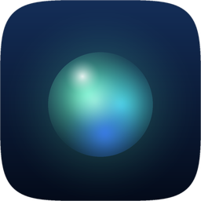

<div align="center">



# Nova Voice Assistant

**Бесплатный голосовой ассистент для Windows с открытым кодом.**
Зажмите сочетание клавиш или просто позовите по имени, скажите, что нужно, и Nova это сделает.

[English](README.md) · [Безопасность](SECURITY.md) · [Участие](CONTRIBUTING.md) · [Изменения](CHANGELOG.md)

</div>

## Что умеет

Скажите **«Нова, открой Телеграм»**, **«Нова, громкость 30»**, **«Нова, нажми Сохранить»** или **«Нова, напиши Вове, что буду через десять минут»**. Частые команды выполняются мгновенно и без интернета. Всё остальное уходит **Claude** или **ChatGPT** через подписку, которая у вас уже есть, без API-ключей. Ответ появляется в небольшой стеклянной панели вверху экрана.

- 🎙️ **Два способа позвать.** Удерживайте `Ctrl+Alt+Space` (меняется в настройках) или просто скажите имя. Имя выбираете вы, по умолчанию «Нова».
- ⚡ **Мгновенные команды без ИИ и без интернета.** Открыть программу, сайт или папку, закрыть окно, нажать кнопку по названию, нажать клавиши, напечатать текст, прокрутить, громкость, музыка, скриншот, поиск в Google и YouTube, время и дата, блокировка и выключение.
- 👁️ **Смотрит на экран, когда попросите.** «Посмотри сюда, что за ошибка?» разбирает область вокруг курсора. «Нажми Принять» находит кнопку даже там, где Windows её не видит, например в играх, и запоминает, как она выглядит и где находится, а заодно в фоне размечает остальные кнопки этого экрана. В следующий раз Nova нажмёт любую из них сразу, без ИИ.
- 💬 **Сообщения в любом мессенджере.** В Telegram сама находит чат и запоминает прозвища: если «Вова» записан как «Вовчикинатор», Nova один раз спросит и запомнит. В Discord, WhatsApp и любых других приложениях работает через их окно по шагам и запоминает их кнопки. В чат, выбранный наугад, без вопроса не отправит.
- 🧩 **Свои команды.** «Запомни рабочий режим: открой Телеграм, потом VS Code, потом громкость 30». Дальше достаточно сказать «рабочий режим».
- 📚 **Учится.** Если ИИ один раз справился с просьбой, в следующий раз Nova выполнит её мгновенно, без ИИ.
- 🎮 **Не мешает играть.** Nova нажимает кнопки как экранный диктор, без мыши и без переключения окон, где программа это позволяет, а потом возвращает вас обратно. Над полноэкранными играми панель не появляется. Пока запущена игра с античитом, Nova не нажимает клавиши и не кликает совсем.
- 🌍 **Понимает любой язык, отвечает на трёх.** Речь распознаётся на любом языке. Интерфейс и ответы — на русском, английском или китайском, новый язык добавляется переводом.
- 🔒 **Приватность.** Речь распознаётся на вашем компьютере. В интернет уходят только те просьбы, с которыми Nova не справилась сама, и только если подключён ИИ: текст, а когда вы просите посмотреть — ещё и скриншот.

## Установка

**Проще всего:** скачайте последний релиз (*Releases → Source code (zip)*), распакуйте и дважды щёлкните **`Install Nova.bat`**. Установщик найдёт или поставит Python, установит Nova в отдельную папку (`%LOCALAPPDATA%\Programs\Nova`, без прав администратора), добавит ускорение для видеокарты NVIDIA, если она есть, создаст ярлыки в «Пуске» и запись в «Установке и удалении программ». Повторный запуск — обновление.

**Вручную** (для разработчиков): нужны **Windows 10 (2004 или новее) или 11**, **Python 3.11 или новее** и [Microsoft Edge WebView2 Runtime](https://developer.microsoft.com/microsoft-edge/webview2/) (в Windows 11 уже есть).

```powershell
git clone https://github.com/vadym-star/nova-voice-assistant.git
cd nova-voice-assistant
pip install -r requirements.txt
python -m nova            # или Nova.bat — запуск без консоли
```

При первом запуске один раз нужен интернет: скачаются модели распознавания (около 550 МБ) в `%APPDATA%\Nova\models`. С Python из Microsoft Store Windows хранит эту папку в `%LOCALAPPDATA%\Packages\PythonSoftwareFoundation.Python…\LocalCache\Roaming\Nova`. Nova появится в трее: правый клик → **Настройки**.

Без видеокарты NVIDIA Nova работает на процессоре: всё работает, просто медленнее (около 2,5 с на фразу вместо 0,2 с на ноутбучном Ryzen; модель распознавания «Быстрая» в настройках ускорит).

**Видеокарта NVIDIA (рекомендуется)** — распознавание примерно в 10 раз быстрее:
```powershell
pip install nvidia-cublas-cu12 nvidia-cudnn-cu12==9.*
```

**ИИ (по желанию).** В Настройках → Интеллект выберите Claude или ChatGPT. Nova покажет, установлено ли приложение и выполнен ли вход, и даст кнопки **Установить**, **Войти** и **Проверить**. Вручную:
```powershell
# Claude (подписка Pro или Max)
irm https://claude.ai/install.ps1 | iex
claude              # войти один раз

# ChatGPT (подписка Plus или Pro)
npm install -g @openai/codex
codex login
```

## Скорость и ресурсы

Замерено на ноутбуке с RTX 3060 с помощью [`tools/voice_bench.py`](tools/voice_bench.py):

| | |
|---|---|
| Услышать имя | ~50 мс |
| Распознать фразу | ~0,2 с |
| Мгновенная команда целиком | заметно меньше секунды |
| Ответ Claude Haiku через подписку | ~3 с |
| Процессор в простое | < 1 % |
| Видеопамять | ~530 МБ |
| Память | ~0,8 ГБ (модели речи), ~0,1 ГБ (интерфейс) |

Голосовой тест: понято 84 команды из 84, ни одного ложного срабатывания на 40 обычных фразах, в тишине и с фоновым шумом.

## Безопасность и приватность

Nova управляет компьютером, поэтому в её основе одно правило: **ИИ никогда не действует сам, а всё необратимое ждёт вашего «да»**. Подробная модель угроз — в [SECURITY.md](SECURITY.md). Коротко:

- ИИ может только попросить навыки Nova, а Nova проверяет каждый шаг. У Claude все собственные инструменты отключены (ни командной строки, ни файлов, ни интернета); Codex работает в своей песочнице только для чтения: файлы читать может, менять — нет.
- Выключение, сообщение в чат, выбранный наугад, ввод в терминал, текст, похожий на команду, и кнопки «удалить», «оплатить», «купить», «отправить», «опубликовать» требуют голосового «да», что бы ни говорил ИИ или веб-страница.
- Текст на сайте или в чате не может незаметно управлять Nova. После того как Nova посмотрела на экран, ничего не отправляется без вашего «да».
- Если команда пришла, пока играют колонки (видео, стрим, голосовой чат, где кто-то сказал «Нова, …»), Nova сначала переспросит.
- Менеджеры паролей и окна ввода паролей Windows никогда не попадают в скриншоты.
- Скриншоты не сохраняются. В визуальной памяти хранятся только маленькие вырезки кнопок (не больше 10 МБ), их можно стереть в настройках.
- Всё хранится в `%APPDATA%\Nova`: настройки, ваши команды, выученное и лог (не больше 3 МБ). В интернет уходят только запросы к ИИ (и скриншоты, о которых вы спросили).

## Запуск от администратора (по желанию)

Windows не позволяет обычным программам управлять окнами, запущенными от администратора (диспетчер задач, установщики, некоторые игры). Кнопка вызова работает везде, но чтобы нажимать кнопки и печатать в таких окнах, включите **Настройки → Поведение → Запуск от администратора**. Тогда Windows будет спрашивать разрешение при каждом запуске Nova. Без этого режима Nova подскажет, если команда не сработала из-за окна администратора.

## Ограничения

- Только Windows.
- Постоянное прослушивание — бета. Лучше всего работает с нормальным микрофоном, когда имя звучит в начале фразы.
- Для ИИ нужна подписка Claude или ChatGPT и официальное приложение. Nova пользуется им так же, как вы, под вашим аккаунтом и по его правилам. Nova не связана с Anthropic или OpenAI.

## Участие

Проще всего помочь новым навыком — это один Python-файл в `nova/skills/`. Подробно — в [CONTRIBUTING.md](CONTRIBUTING.md).

## Лицензия

Разработано [VadymStar](https://github.com/vadym-star). [MIT](LICENSE).
